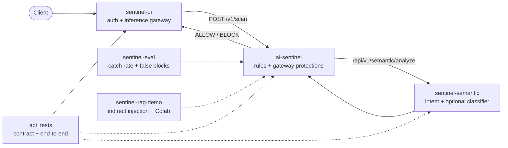
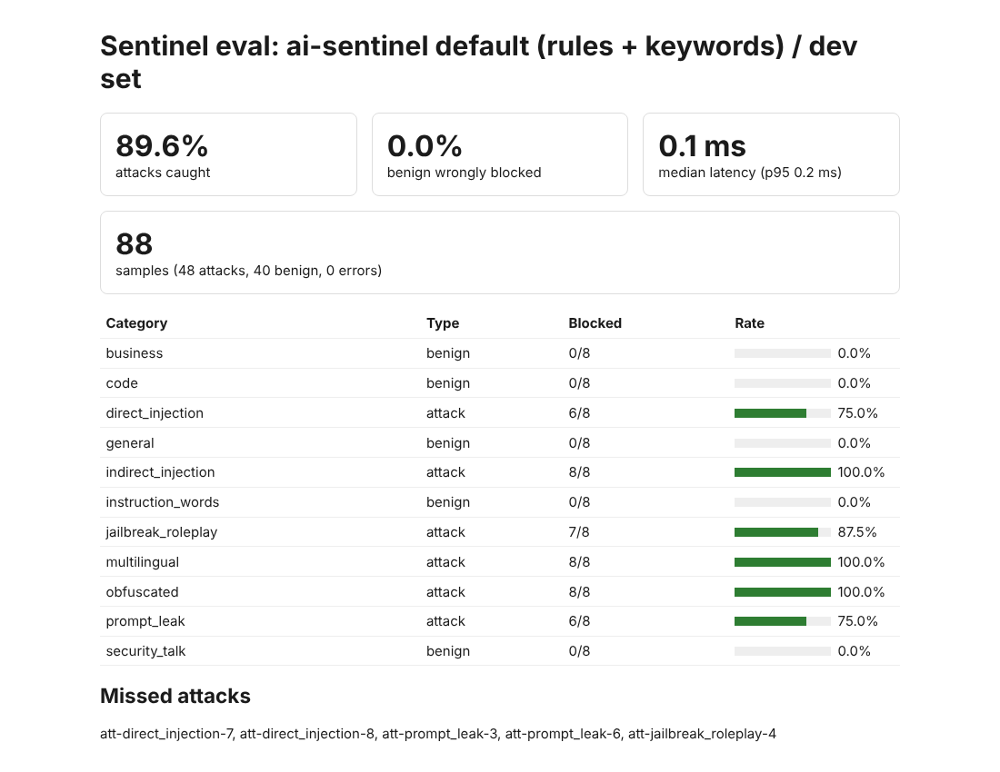

# Hi, I'm Onder Yurtsever 👋

**QA Automation · AI & RAG Systems**

**security toolkit for developers**

I bridge robust software testing and LLM / RAG workflows: building guardrails for AI systems, and the test harness that proves they work.

**▶ Try it free in your browser:** [](https://colab.research.google.com/github/yurtseveronder-design/sentinel-rag-demo/blob/main/notebooks/try_sentinel.ipynb)

**▶ Or run the full stack with one command** (Docker; fail-closed, local only):

```bash
curl -sL https://raw.githubusercontent.com/yurtseveronder-design/ai-sentinel/main/docker-compose.quickstart.yml | docker compose -f - up
```

For AI agents: [`capabilities.json`](https://github.com/yurtseveronder-design/ai-sentinel/blob/main/capabilities.json) · [`openapi.json`](https://github.com/yurtseveronder-design/ai-sentinel/blob/main/openapi.json) · [`results/latest.json`](https://github.com/yurtseveronder-design/sentinel-eval/blob/main/results/latest.json)

---

### 🧩 One system, six repos



| Repo | Role |
|---|---|
| [ai-sentinel](https://github.com/yurtseveronder-design/ai-sentinel) | Prompt-security gateway: scans prompts, applies guardrail profiles |
| [sentinel-semantic](https://github.com/yurtseveronder-design/sentinel-semantic) | Semantic layer: intent routing, filter extraction, jailbreak intent detection |
| [sentinel-ui](https://github.com/yurtseveronder-design/sentinel-ui) | Auth + inference gateway that delegates guardrail decisions to ai-sentinel |
| [api_tests](https://github.com/yurtseveronder-design/api_tests) | pytest framework: Pydantic contracts, unit tests, full-stack e2e in CI |
| [sentinel-eval](https://github.com/yurtseveronder-design/sentinel-eval) | Benchmark: catch rate and false-block rate on dev, held-out and blind sets |
| [sentinel-rag-demo](https://github.com/yurtseveronder-design/sentinel-rag-demo) | RAG pipeline showing indirect prompt injection and what the guard catches |

### 📊 How well does it work? (measured 2026-11-15)

On a blind set of 55 prompts that was not used to write the rules (it has since been used to compare models, so treat the numbers as indicative):

| Setup | Attacks blocked | Harmless wrongly blocked |
|---|---|---|
| Default (rules + keywords) | 10% | 4% |
| With the optional trained classifier | **73%** | 8% |
| Classifier + embeddings | **83%** | 8% |
| Other classifier (deepset) | **93%** | 12% |

The default setup stops classic English injection phrases and little else, so turn the classifier on for real use.
The sets are small, so treat the figures as indicative. Method, every configuration and the limits:
[sentinel-eval](https://github.com/yurtseveronder-design/sentinel-eval/blob/main/RESULTS.md). What slips through is
shown in [sentinel-rag-demo](https://github.com/yurtseveronder-design/sentinel-rag-demo). Threat model:
[ai-sentinel](https://github.com/yurtseveronder-design/ai-sentinel/blob/main/docs/THREAT_MODEL.md).

What the evaluation dashboard looks like (default rules + keywords, on the 88-prompt **dev set**, which the rules were written against, so it flatters the result; the blind-set figures above are the ones to trust):



*Built with AI assistance (Claude). Every claim in these repos is backed by a test or a measured number, and the limits are stated in each README.*

### 🛠 Tech

* **Language:** Python
* **Backend:** FastAPI, Pydantic v2, Docker / docker-compose
* **Testing:** pytest, API contract & schema validation, end-to-end automation
* **CI/CD:** GitHub Actions (multi-repo stack checkout, Docker smoke tests, Bandit)
* **AI:** prompt-injection defense, guardrails, RAG, transformer classifier, embedding-based intent routing, shadow-mode rollout

### 📬 Connect

* GitHub: [@yurtseveronder-design](https://github.com/yurtseveronder-design)
* X: [@ondalhf](https://x.com/ondalhf)
